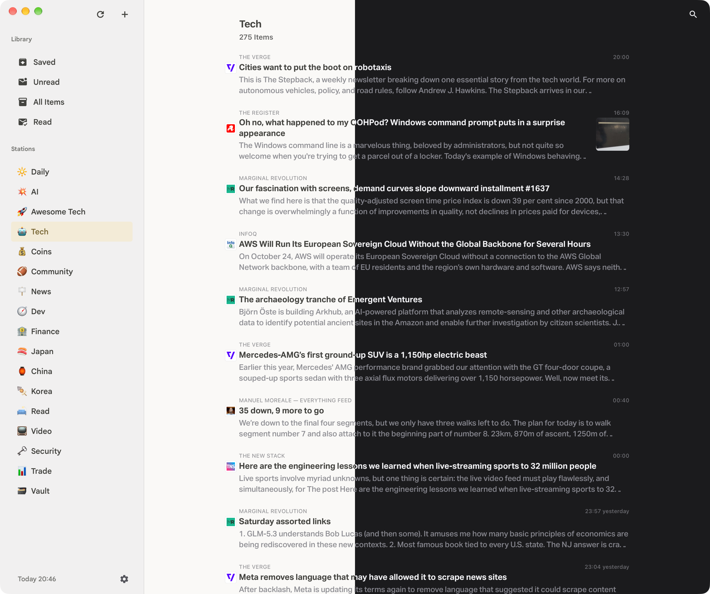
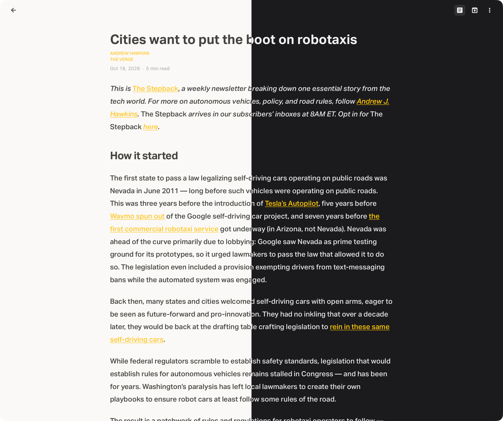

# KiJi

### <ruby>記事<rt>きじ</rt></ruby> · A local, modern RSS reader.

**[kiji.yomilab.app](https://kiji.yomilab.app)** · [Download](https://kiji.yomilab.app/download/) · [Changelog](./CHANGELOG.md)

Free, native builds for macOS, Windows, and Linux. Quick to open, light to keep around, and your reading never leaves your device.

## Features

- **🏷️ Stations.** Group feeds by tags. Views switch between unread, read, and saved; there is no algorithmic timeline.
- **📖 Reader mode.** Defuddle + Readability — two engines to parse raw page HTML into article text. Wide images, galleries, a full-window image viewer, reading time, and a progress bar.
- **🎨 Reader themes.** 13 book-style themes (Paper, Sepia, Washi, E-Ink, Solarized, Midnight, and more), each in a light and a dark version.
- **🤖 AI assistants (MCP).** Connect Claude, Cursor, VS Code, Codex, or any MCP app to ask about the article you're reading, summarize a station's week, or search your feeds. Off by default and read-only unless you allow changes.
- **🗂️ Manage Feeds.** Feeds, stations, Library views, and import/export in one window. Paste a link to preview a feed before adding it.
- **📝 Markdown sync.** Sync saved articles to a local folder as Markdown.
- **🌙 Made for the long run.** Can keep running after you close the window so feeds stay fresh (Dock on Mac, system tray on Windows and Linux).

## Preview

## Theme development

Run `npm run storybook` to open isolated theme-debugging stories for the
Sidebar, article list, and article view. The Storybook toolbar switches the
light/dark color theme, Modern/Classic surface style, and platform CSS.

Use `npm run build:storybook` to verify the static Storybook bundle.
Storybook uses deterministic browser-only fixtures: it does not connect to
KiJi's database, scheduler, filesystem, network services, or Tauri APIs, and it
cannot reproduce native macOS vibrancy or WKWebView compositing.

## Privacy

- Local storage
- OPML import/export for portable subscriptions.
- Saved articles sync to your local machine

  📰 KiJi · <a href="https://kiji.yomilab.app">kiji.yomilab.app</a>

